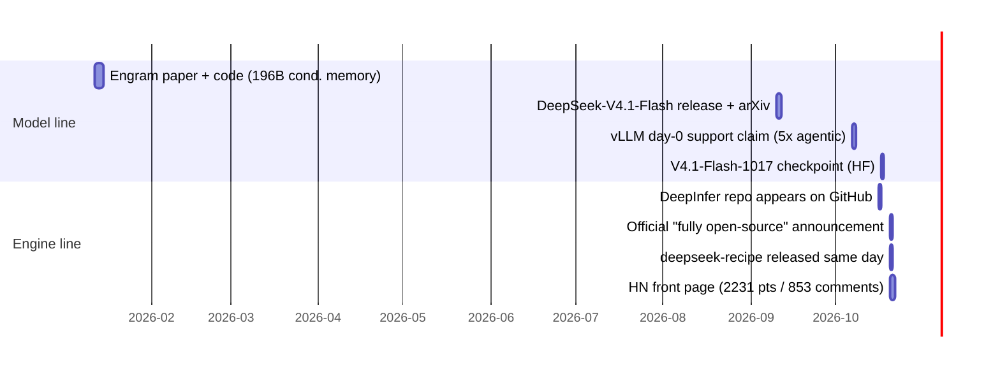

# DeepInfer Deep Research Report

| | |
|---|---|
| Date | 2026-10-22 |
| Subject | [deepseek-ai/DeepInfer](https://github.com/deepseek-ai/DeepInfer) @ commit `9bd9cf2` (main) |
| Methods | GitHub API + full-source code reading + web research (HN/Reddit/Zhihu/X/official channels) |
| Overall confidence | High for code facts (read from source); Medium for community/architecture claims (2+ independent secondary sources); Low where marked |
| Purpose | Select a research direction on top of DeepInfer; direction locked at the end of this report |

## 1. Executive summary

DeepInfer is the open-source release (2026-10-16/20, Apache-2.0) of DeepSeek's production inference framework that serves DeepSeek-V4.1-Flash. It is a vLLM-derived engine (with SGLang/TensorRT-LLM influence) locked to two hardware stacks: NVIDIA SM100 and Huawei Ascend 950. Official figures: one cluster serves 155T tokens/day at $38/GPU-hour valley-price revenue; ~96% input cache hit rate; >25k decode tok/s. The release covers offline inference only — the KV cache storage system, the four load balancers, and E/P/D disaggregation orchestration remain closed (described in the official deployment Q&A and a Zhihu companion post). Community reception is split between "nuclear bomb" (HN 2231 points) and "this is an engine, not a service" — with the recurring criticism that all headline numbers are self-reported and not independently reproducible.

The most research-relevant mechanism is **DSpark confidence-scheduled verification**: a linear ConfidenceHead predicts a per-draft-token acceptance probability; a GPU kernel then allocates a fixed batch-level verification budget by globally ranking cumulative confidence products. The prediction, the allocation, and an (unused) online calibration error signal together form an **auditable decision pipeline that is statistically underexploited** — this is the locked research direction (§6).

## 2. Timeline

- Repo history is a single squashed `initial commit` + 3 docs/dependency commits; 18.3k stars, 1.9k forks within 6 days; issues disabled (PRs accepted).
- Future DeepSeek model inference code is announced to keep landing in this repo.

## 3. System architecture (from official Q&A + README)

**Serving shape**: disaggregated Vision-Encoder / Prefill / Decode clusters plus dedicated KV storage nodes. Prefill runs EP2–8/DP2–8 on commodity 8-GPU machines; decode runs Wide-EP EP64–128 on 64–128 GPU supernodes; TP/CP unused. Attention DP with #DP = #EP.

**Load balancing (closed-source, described in Q&A)**:
- Prefill LB: 4 context-length tiers (<16K/16–64K/64–256K/≥256K) with dynamically redistributed engine quotas; within a GPU, each prefill step's chunk size `q` is solved from a fitted quadratic cost model `cost(q, c)` under a nanosecond time budget and a 32,768-token cap; the budget is tightened by an all-reduce MIN across the DP group. Measured moe_lb ≈ 1.05–1.09.
- Decode LB: balances request count and total KV length simultaneously ("DualPath" intra-group scheduling).
- EPLB: hot-expert replicas (4 redundant/GPU prefill, 1 redundant/GPU decode), N-step load statistics windows, M-step re-assignment over NVLink symmetric memory.
- Overall: ~80% of a perfectly balanced offline benchmark.

**KV cache (closed-source storage, described)**: paged block KV on a dedicated 3FS cluster (~100 PiB SSD, 10+2 EC, TTL 3 days agent / 7 days chatbot; a 3-day TTL costs chatbot 0.5–1% hit rate). SWA KV kept in host memory as fixed `StateBlock` slots (20 layers × 134 tokens × 528 B ≈ 1.42 MB/sequence, MXFP8), stored only at 128-token boundaries with a 6-token ring-buffer overshoot allowance. Hit policy: hit length determined by block KV; SWA miss ⇒ back off one 128-token block and recompute. Max hit length L−134 (window + speculative backtracking).

**SWA bounded replay**: recompute only the last 128 tokens; the query at position `i` attends to keys in `[max(s, i−127), i]`. Decoder-side replay nearly halves total prefill computation (reconstructing exactly would require 2,560 tokens through 20 decoder layers).

**Quantization**: FP4 main KV (per-16, e4m3, no global scale), MXFP4 indexer KV and MoE routed-expert weights (per-32, ue8m0).

**Open-source engine scope**: kernels (FlashMLA, DeepGEMM, DeepEP, DeepSelect, TileLang ops), model runtime for V4.1-Flash, DSpark draft/verify, SWA bounded replay, zero-overhead async scheduler, batch-invariant inference, deterministic sampling, structured outputs, eval harness (AIME/GPQA/HLE with unbiased pass@k). Explicitly NOT included: KV cache system, VE/P/D disaggregation glue, cross-replica load balancing.

## 4. Code-level findings (read from source, commit `9bd9cf2`)

### 4.1 DSpark = DFlash draft engine + confidence-scheduled variable-length verification

- **ConfidenceHead** ([deepinfer/model_executor/models/mtp/dflash.py:46](file:///Users/jackson/DeepInfer/deepinfer/model_executor/models/mtp/dflash.py#L46)): `ReplicatedLinear(n_embed + markov_rank → 1)`, one scalar per draft position, per-step temperature; fused TileLang kernel. Optional Markov correction path (`markov_w1`: vocab→rank embedding; `markov_w2`: rank→vocab logits add) adjusts draft logits with a bigram-like signal.
- **Draft structure**: DFlash has `num_nextn_predict_layers` dedicated layers (default 5, up to 7 in tests); draft KV weights are kept in two layouts (main-cache path and draft path); drafts init from the golden token plus `dspark_noise_token_id` fillers; multi-target-layer feature projection (`dspark_target_layer_ids`).
- **The allocator** ([deepinfer/model_executor/layers/tilelang_ops/schedule_mtp_varlen.py:35](file:///Users/jackson/DeepInfer/deepinfer/model_executor/layers/tilelang_ops/schedule_mtp_varlen.py#L35)): batch-level budget `total_q` is fixed by the CPU scheduler; per-(seq, position) marginal value = cumulative product of predicted rates; global stable top-`total_q − num_seqs` ranking distributes extra verified tokens. Because rates ≤ 1 make cumprod monotone non-increasing, every sequence's selected positions form a prefix — matching the Q&A's "prefix subset" language. The repo ships a PyTorch reference implementation and kernel-vs-ref equality tests.
- **ZOS (zero-overhead scheduler) coupling** ([deepinfer/worker/worker.py:191](file:///Users/jackson/DeepInfer/deepinfer/worker/worker.py#L191)): CPU runs one step ahead and only fixes the total budget; per-request lengths are recomputed **on the GPU from the previous step's confidences** (necessarily one step stale), written to a pinned buffer (cumprod → global sort top-k → fused remap scatter). Fresh sequences (remap = −1) have zero rates.
- **Q&A production numbers**: dynamic verification cuts verified tokens/step 5.00 → 3.2–4.4 with accepted length essentially unchanged (3.29 vs 3.20), worth +4–7% throughput at ~60 concurrent sequences/rank; +11.0% at 96. A full table over concurrency 16–96 is provided.

### 4.2 The calibration monitor exists but does not feed back

The Ascend sampler kernel fuses `|actual_accept_prob − predicted_confidence|` per verified position ([deepinfer/model_executor/layers/tilelang_ops/asc/sampler.py:556](file:///Users/jackson/DeepInfer/deepinfer/model_executor/layers/tilelang_ops/asc/sampler.py#L556)), aggregates it into `batch_confidence_error` ([deepinfer/sequence.py:248](file:///Users/jackson/DeepInfer/deepinfer/sequence.py#L248)), and the engine logs a rolling `avg_confidence_error` ([deepinfer/engine/stats_logger.py:236](file:///Users/jackson/DeepInfer/deepinfer/engine/stats_logger.py#L236)). **This error signal is monitored but never used by the allocation policy.** The audit loop is half-built.

### 4.3 Allocator edge case found during this study

Zero-rate (fresh) sequences are documented to stay at one token ("cumprod stays 0.0"), but zeros still participate in the global ranking with a lowest-flat-index tie-break. When `total_q − num_seqs` exceeds the number of positive marginal values, **zero-confidence sequences win extra slots**. Reproduced with a hand-derived fixture: rates [[0.5, 0.2]], remap [−1, 0], `total_q=5` ⇒ seqlens `[2, 3]`, not `[1, 4]` ([dflash_alloc.py, fixture 3](file:///Users/jackson/deepinfer-research/dflash_alloc.py)). Consequence: under budget slack, compute is spent verifying tokens predicted to be rejected — small in production (budget is usually tight) but a real policy wrinkle, and a free seat for a principled fix (e.g., excluding non-positive marginals or epsilon-greedy exploration).

### 4.4 Statistical hygiene in the repo

The eval harness uses the unbiased pass@k estimator and, on ragged sample counts, approximates with `min(k, n)` instead of dropping tasks, with the upward-bias rationale written out ([eval/common/passk.py:31](file:///Users/jackson/DeepInfer/eval/common/passk.py#L31)). Batch-invariance and KL tests exist ([tests/models/test_batch_invariant.py](file:///Users/jackson/DeepInfer/tests/models/test_batch_invariant.py), [tests/models/test_kl.py](file:///Users/jackson/DeepInfer/tests/models/test_kl.py)). The codebase is unusually statistics-literate for systems code — which makes the unexploited calibration signal (§4.2) more striking.

## 5. Landscape and community (web research, 2026-10-20/22)

- **Model**: V4.1-Flash = 552B MoE backbone (≈8B activated prefill / 16B decode), CED architecture (20 causal-encoder + 20 decoder layers; decoder global KV projected from last encoder hidden state), Engram 196B conditional memory, mHC (Manifold Hyper-Connections), CSA2 sparse attention, YOCO cross-layer KV reuse, FP4 main KV ⇒ 890 bytes/token global KV (~1/4 of V4-Flash; ~1/8 including SWA), 1M context, native vision, MIT-licensed model code.
- **Comparisons**: no public head-to-head benchmark exists. vLLM claims day-0 CED-aware support with "5x agentic throughput"; SGLang supports DSpark since 0.3.5; TensorRT-LLM reportedly lagged on V4. All headline DeepInfer numbers are self-reported production metrics; SemiAnalysis's inferencex has been asked to include it. This reproducibility gap is an open flank.
- **Criticism**: open-sourced is "an engine, not a service" (no KV store ⇒ no prefix reuse for multi-turn ⇒ repeated prefill eats DSpark's savings; no PD disaggregation fallback ⇒ not production-deployable alone); hardware locked to SM100/Ascend 950 limits community benefit; internal draft model "somewhat newer" than released.
- **Related repos**: DeepSpec (speculative-decoding training/eval full stack — the DSpark upstream), DeepSelect (TopK kernels), TileKernels, DeepJIT (C++20 CUDA JIT), deepseek-recipe (Rust tokenization), Engram.

## 6. Research direction (locked with the user, 2026-10-22)

**Chosen: Path A — decision theory of DSpark's confidence-scheduled verification**, with Mac-only CPU simulation. Runner-up Path C (rebuilding the closed load balancers/KV store) was deferred; Path B (cloud reproduction of the Q&A table) rejected for budget reasons (no GPU access).

Grounds: (i) it extends the established research line "model scores → auditable decisions" (FDR / freeze protocols / evidence boundaries); (ii) the repo's own reference implementation + Q&A table make it CPU-reproducible end-to-end; (iii) it attacks the exact flank the community flagged — self-reported, unreproducible policy numbers; (iv) three concrete gaps are already evidenced: the monitor-not-policy calibration signal (§4.2), the zero-rate slack wrinkle (§4.3), and one-step-stale confidences under ZOS (§4.1).

**Shape of the allocation problem** (from §4.1): maximize Σ expected accepted tokens subject to a hard token budget; greedy on marginal cumprod values is exchange-optimal when values are exact and costs are unit. The research questions sit exactly where those assumptions break:
1. **Ranking sufficiency**: the allocation depends only on the ranking of cumprods (any monotone transform of rates yields the same allocation). So policy quality reduces to ranking quality — measurable with concordance statistics, independent of calibration. Auditable by construction.
2. **One-step staleness under ZOS**: confidences are always from the previous step; quantify the regret of acting on stale rankings vs. the ideal, and whether a cheap staleness correction helps.
3. **Selective-verification error control**: treat "verified but rejected" slots as false discoveries; can an FDR-style wrapper bound the wasted-verification fraction across steps without losing throughput? The `batch_confidence_error` plumbing (§4.2) is the natural substrate.
4. **Budget shaping**: the CPU side fixes `total_q` from a profiled throughput curve; the greedy allocation is optimal only for a *given* budget. Study joint (budget, allocation) optimization vs. the measured Q&A operating points.
5. **Fix the edge case** (§4.3) and upstream it as a PR candidate.

**Feasibility probe (done)**: numpy port of the reference allocator + 4 hand-derived fixtures, all passing, including the edge case ([dflash_alloc.py](file:///Users/jackson/deepinfer-research/dflash_alloc.py)). Python 3.12 venv + numpy 2.5.4 at [/Users/jackson/deepinfer-research](file:///Users/jackson/deepinfer-research).

**Next milestones** (proposal, open to user redirection):
1. Simulation harness: acceptance-rate generator calibrated to the Q&A table's operating points (fixed-5 accepted length 3.20–3.30 at concurrency 16–96), replay the allocator, and reproduce the direction (+, magnitude) of the 4–7% gain under the same assumptions the Q&A states.
2. Ranking-quality study: inject controlled ranking errors into predicted confidences; measure throughput degradation curves ⇒ an auditable "how good must the ranking be" bound.
3. FDR-style selective-verification wrapper simulated on top of the same harness.
4. Write-up: methodology-first artifact (interview-defensible: every number traceable to a frozen seed + pinned commit).

> [Executed: milestones 1 and 2 completed and closed — see §10 Outcomes for the results, and `RESULTS_LEDGER.md` for the dated session history. Milestone 3 (FDR-style selective verification first, ZOS staleness second) remains a PROPOSAL only.]

## 7. Sources

Primary (High confidence):
- [DeepInfer repo](https://github.com/deepseek-ai/DeepInfer) — README, `doc/inference_deployment_qa.md`, source @ `9bd9cf2` (read locally, cloned 2026-10-22)
- [DeepSeek-V4.1-Flash model card](https://huggingface.co/deepseek-ai/DeepSeek-V4.1-Flash) / [1017 checkpoint](https://huggingface.co/deepseek-ai/DeepSeek-V4.1-Flash-1017)
- [V4.1-Flash technical report, arXiv 2609.19969](https://www.alphaxiv.org/abs/2609.19969)
- [Official deployment Q&A companion Zhihu post](https://zhuanlan.zhihu.com/p/2095560295930508953) (direct fetch blocked; content cross-verified via the in-repo Q&A doc)

Secondary (Medium confidence):
- [Official announcement](https://api-docs.deepseek.com/news/news261017/) · [the-decoder](https://the-decoder.com/deepseek-open-sources-the-inference-engine-that-powers-its-fastest-and-cheapest-ai-model/) · [marktechpost](https://www.marktechpost.com/2026/10/20/deepseek-deepinfer-open-source-inference-framework/) · [thenewstack (Ascend angle)](https://thenewstack.io/deepseek-deepinfer-huawei-nvidia/) · [latent.space economics](https://www.latent.space/feed)
- [HN thread 50163277 (2231 pts)](https://news.ycombinator.com/item?id=50163277) · [r/LocalLLaMA](https://www.reddit.com/r/LocalLLaMA/comments/1xanm55/deepseek_released_deepinfer_open_source/) · [vLLM blog](https://vllm.ai/blog/2026-10-07-deepseek-v41-flash) · [SemiAnalysis inferencex](https://inferencex.semianalysis.com/blog/deepseekv4-16t-day-0-to-day-43-performance)
- Zhihu analyses (fetch-blocked, via search snippets): [2095996493689787689](https://zhuanlan.zhihu.com/p/2095996493689787689), [2095986687193126834](https://zhuanlan.zhihu.com/p/2095986687193126834), [2095948594222208963](https://zhuanlan.zhihu.com/p/2095948594222208963)

## 8. Confidence assessment

- **High**: all §4 code claims (read from cloned source); repo timeline (git history); allocator edge case (fixture-reproduced).
- **Medium**: V4.1-Flash architecture parameters (2+ secondary sources consistent, arXiv); community sentiment split (multiple threads); production figures (official, self-reported — that is their limitation, not ours).
- **Low**: internal-vs-open kernel deltas ("5–10% slower", Q&A, unverifiable); Zhihu post details behind 403.

## 9. Methodology

Round 1: GitHub API metadata + org repo census + full clone. Round 2: targeted source reading (engine → worker → MTP/confidence chain → eval/tests). Round 3: background web agent (30 tool calls, HN/Reddit/Zhihu/X/official). Round 4: feasibility probe (numpy port + fixtures) and direction selection in dialogue with the user. All web-derived claims carry inline sources; fetch-blocked sources are marked and cross-verified rather than silently trusted.

## 10. Outcomes (2026-10-24)

Milestones 1 and 2 were executed against the direction locked in §6 and are closed; the public synthesis is `WRITEUP.md`. Every number in this section is captured from a committed artifact by `sim/build_writeup_numbers.py` (fixture `results/writeup_numbers.json`, guarded by `tests/test_writeup_numbers.py`) — none is retyped from chat memory.

**M1 — anchor-table replay.** Emission convention adjudicated from upstream code: the engine emits **k+1** tokens per verification step (accepted prefix plus the final fresh row), encoded as `EMIT_BONUS = 1`; the Q&A accepted-length statistic is frozen as the mean accepted draft count k. The generator calibrates to the table's own fixed-5 column: accepted length in [3.29, 3.32] at every concurrency, mean 3.3042 (seed 20261022, horizon 6000). The selection row reproduces in sign and magnitude — -1.60% [-1.62, -1.59] against the published -1.5% at conc 16, where dynamic verifies 4.438 tokens per sequence and accepts 3.196 against fixed-5's 3.307 — while all five scoring rows fail in the same direction. The binding quantity is the dynamic accepted length: the published ladder peaks at +11.0% at conc 96, where under matched budget the published ratio is 3.15/3.24 = 0.9722 and the calibrated generator reaches 2.656/3.240 = 0.8198. Over the committed sign map (75 t_pow cost points and 30 saturation points) the concurrency-16 zero-crossing lies above the concurrency-32 one at every exponent tested, so the anchor's sign ladder and its conc-16 magnitude are JOINTLY irreproducible — a structural property of the flip-curve geometry, not a tuning miss. Where the pattern is reachable at all, conc-16 lands at -0.05% to -0.37%.

**M2 — rank sufficiency.** Ranking-only noise applied in rate space over 1440 paired sims. Reachable band: a probability-constrained head's window-length concordance cannot fall below its plateau — V1 0.232-0.287, V2E 0.190-0.243, floor ~0.19-0.29 — so reachable ranking quality is the band [plateau, 1] and "scrambled" does not mean tau_K = 0. The auditable bound, stating the concordance needed to keep >= 50% of the ideal-band gain, is hierarchical: stable regime V1 [0.441, 0.453] and V2E [0.392, 0.404], with named exceptions V1 conc-32 = 0.734 (DEGENERATE: its ideal gain +0.16% halves within the first noise step), V2E conc-32 = 0.545 (ideal gain +4.38%), V2E conc-16 = 0.444, and second-regime conc-96 = 0.331 for V1 and 0.284 for V2E. The two generators differ row by row: only the two conc-32 rows reach 6.7-27.4x on ideal gain, every other positive row is 1.4-2.1x. Non-monotonicity is recorded rather than smoothed away: 24 FINDING cells (18 V1 + 6 V2E), all at sigma 6.4 -> 12.8.

**Tension attribution.** Under a near-ideal head the conc-96 accepted/verified ratios are anchor 0.9722, V1 0.8198, V2E 0.8747: adopting the sharper-separation generator closed 0.0549 of the 0.1524 gap = 36.0%, leaving a residual 64.0% attributed to rate separation and the depth profile. Conc-16 stays unresolved in the same direction — the anchor's -1.5% sits below V1 -0.05% and V2E +1.90%. Ranking quality is necessary but not sufficient.

**Reproducibility.** Generator seed 20261022, horizon 6000 steps; paired seeds `L2_SWEEP_SEED + i` for i in [0, 12); bootstrap seed 20261101, 10000 resamples. The M1 slice was frozen at commit `c842e85` before scoring and Milestone 2 closed at `be55c16`; the upstream evidence clone stayed at `9bd9cf2` and was never edited. The fast suite and the `-m slow` pin both pass, with durations recorded in `RESULTS_LEDGER.md`.

**Artifacts.** `results/m1_report.md`, `results/m2_report.md`, `results/sweep_l2.md`, `results/sweep_m2.md`; conventions in `sim/convention.md`; the guard fixture in `results/writeup_numbers.json`.

**Evidence boundary.** Published Q&A figures are claims, not ground truth; the simulator reads current-step true rates through an idealized head on a steady batch, so every dynamic gain reported here is an upper bound; and the threshold tables are conditioned on one noise realization per batch geometry. See §5 of each milestone report for the full statement.
